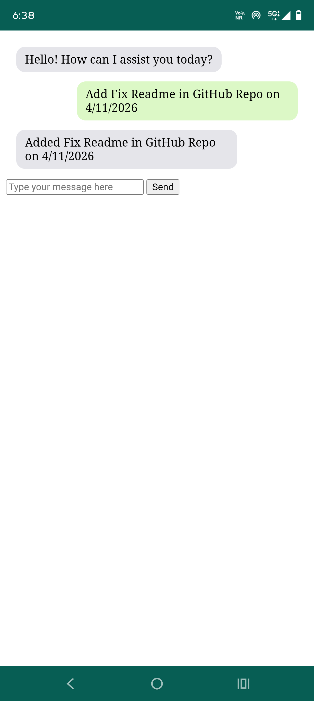
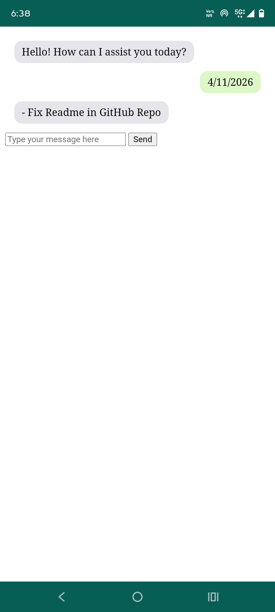

# PAST: Personal Architect Shaping Time

A WhatsApp-style, text-based chat app for your daily schedule. Type a date to see that day's tasks. Type `add` or `remind` to create new ones. It is a mobile-first PWA that installs on Android and runs on free hosting.

**Live app:** https://abhishek-gs07.github.io/PAST/


**Why I built this**

I wanted a schedule app that works like a chat, in its own app instead of inside WhatsApp.


<p>

&#x20; 

&#x20; 

</p>

## 

## What it does

|You type|PAST replies|
|-|-|
|`6/11/2026`|The tasks scheduled for that day, or "No Tasks Scheduled"|
|`add swim on 6/11/2026`|Saves the task and confirms|
|`remind call mom on 28/10/2026`|Same as `add`|
|`remind to pay rent on 1/11/2026 18:30`|Same, with a time|

PAST is a manager, not a pusher. On an empty day it just says so.

## Rules

* **Dates** are day first: `DD/MM/YYYY` or `DD-MM-YYYY`. Single-digit day and month are allowed. They are stored as `YYYY-MM-DD`.
* **Task fields:** `date`, `time`, `session`, `title`, `note`, `nts`, `uid`.
* **Time:** write it as 24-hour `HH:MM` anywhere in the message (for example `18:30`).
* **Sessions:** `morning` 6-12, `afternoon` 12-16, `evening` 16-19, `night` 19-6. If a time is given, the session is calculated when the task is read.
* **Neither time nor session:** the task is saved as `morning` and flagged `nts: true` ("not time specified").
* **Splitting:** PAST cuts the message at the last `on`, so `add call mom on phone on 28/10/2026` works.

## Built with

* HTML, CSS and vanilla JavaScript (ES modules)
* Firebase Firestore (database) and Firebase Authentication (Google sign-in)
* A service worker and `manifest.json` (installable PWA)
* GitHub Pages (hosting)

Everything runs on free tiers (Firebase Spark plan, no credit card).

## Run your own copy

1. Create a Firebase project and add a **Web app**.
2. Enable **Firestore** and **Authentication > Google**.
3. Replace `firebaseConfig` in `app.js` with your own web config. This config is public by design. Your security comes from the rules below.
4. Publish these Firestore rules:

```
rules\_version = '2';
service cloud.firestore {
  match /databases/{database}/documents {
    match /tasks/{taskId} {
      allow read, update, delete: if request.auth != null
                                  \&\& resource.data.uid == request.auth.uid;
      allow create: if request.auth != null
                    \&\& request.resource.data.uid == request.auth.uid;
    }
  }
}
```

5. Add your domain (for example `yourname.github.io`) under **Authentication > Settings > Authorized domains**.
6. Run locally with VS Code Live Server and open **`http://localhost:5500`**. Do not use `127.0.0.1`, because Firebase does not authorize it and login fails.

## Known gotchas

* The service worker uses a cache-first strategy. If a change does not show up, unregister the worker in DevTools > Application, then hard refresh, or bump the cache name in `sw.js`.
* Typing a date before tasks finish loading can show "No Tasks Scheduled".
* Using `add` while signed out is not handled gracefully yet.

## Roadmap

* Flexible dates ("tomorrow", "28th october")
* Show what is already on a day when adding a task
* Morning prompt for tasks with no time (reschedule or mark finished)
* Voice input and spoken replies
* A menu feature ("What's for breakfast?")
* Support for other users

## Licence

MIT

